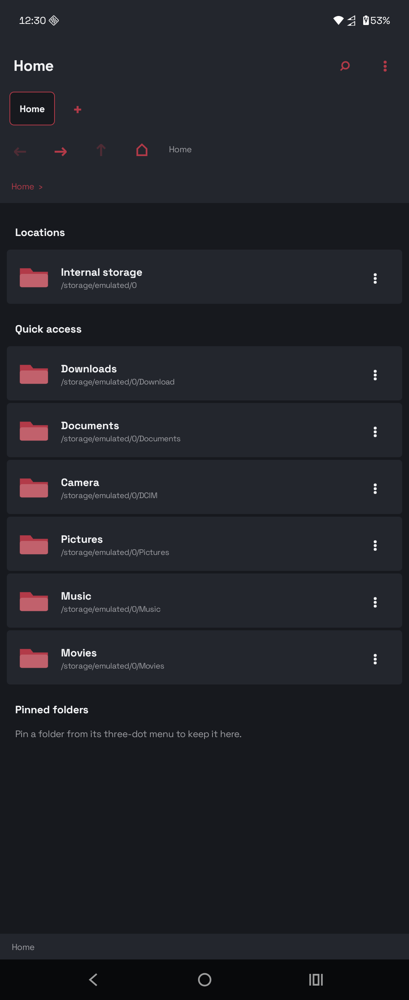
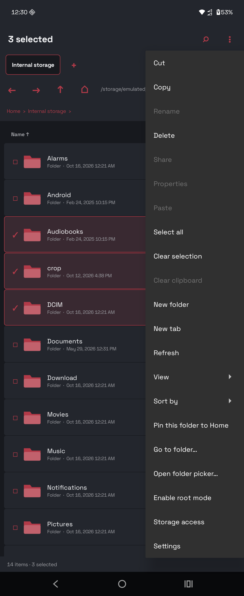
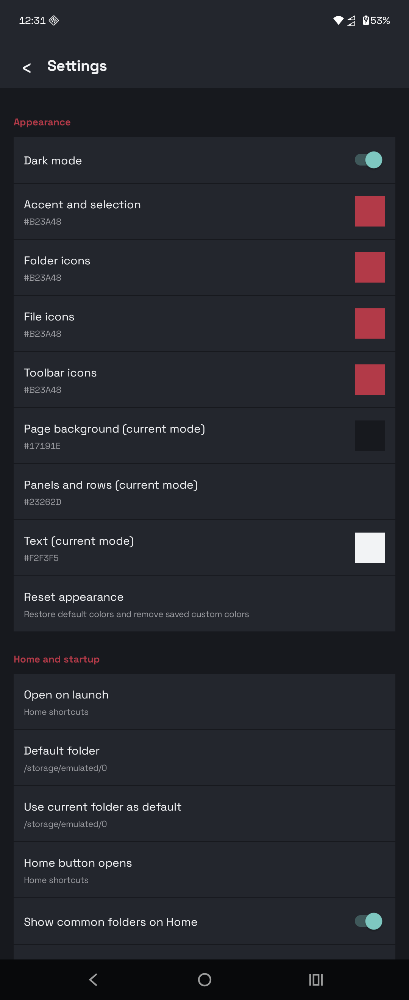

# SimpleFiles

A file manager for Android 7.0+ that lets you manage your fucking files. Written in Java, with an interface inspired by Windows Explorer, because apparently “folders, useful buttons, and predictable navigation” needed to become a controversial product strategy.

## Features

### File browsing

- Multiple tabs with independent navigation history.
- Back, Forward, Up, and Home controls.
- Clickable breadcrumbs and an editable folder address.
- Details list and large-icon views with direct View and Sort controls.
- Image thumbnails.
- Sorting by name, modification date, size, or file type.
- Ascending and descending order, with folders first.
- Hidden-file and filename-extension visibility controls.
- Folder search, text previews, and file properties.

### File operations

- Multi-select, Select all, and Clear selection.
- Cut, Copy, Paste, Rename, Delete, and Share.
- New-folder creation.
- A permanent two-row command ribbon with drawn icons and labels.
- Direct Cut, Copy, Paste, Rename, Delete, New folder, Share, Properties, and Pin buttons.
- Selection-aware actions that disable themselves when they do not apply.
- Clipboard status and faded icons for items waiting to be moved.
- Paste conflict choices: keep both, skip existing items, or replace existing files.
- Confirmation before replacing matching files.
- Failed or skipped moves remain in the clipboard.
- Filename validation and protection against renaming over an existing entry.

Select your files with the checkboxes or a long press, then tap the button. The commands stay visible; unavailable actions are dimmed.

### Colors and appearance

- Light and dark modes, including app dialogs.
- Dark-mode gray brightness from black to white, with automatic text contrast.
- The gray slider sets page and panel shades together; individual color controls remain available.
- Custom accent, folder-icon, file-icon, and toolbar-icon colors.
- Custom background, panel, and text colors.
- Separate background, panel, and text settings for light and dark modes.
- RGB sliders, hexadecimal color input, and a live color swatch.
- Preset colors and a saved custom-color palette.
- Individual color resets and a complete appearance reset.
- Tintable file and folder icons; photo thumbnails keep their original colors.

### Home and settings

- A dedicated Settings screen with permanent “Developed by ZoeyKL” credit.
- Home shortcuts for internal storage and common folders.
- Pin and unpin your own folders.
- Long-press a Home shortcut to open it in another tab.
- Optional common-folder shortcuts.
- Startup choices: Home, internal storage, Downloads, a custom folder, or the last visited folder.
- Choose a default folder by browsing, entering its path, or using the current folder.
- Configure the Home button to open Home or your default folder.
- Preserve tabs, selection, and clipboard across Activity recreation.

### Additional tools

- ZIP archive listing and extraction.
- Optional root browsing and file operations through `su`.
- Root Mode switches in the browser and Settings; a successful grant is remembered between launches.
- Android folder-provider access.
- Opening files in compatible installed applications.
- Single-file and multiple-file sharing.

## Things you should understand before opening an issue

**Delete is permanent.** There is no recycle bin or undo button, so read the confirmation instead of treating it as decorative paperwork.

**Root support requires a rooted device that grants access.** Installing a file manager does not magically give it ownership of Android.

**The archive viewer handles ZIP files.** Seeing a recognizable icon beside a RAR or 7z file does not mean an entire decompression library appeared through optimism.

**Android storage restrictions still apply.** Folder providers can also limit available operations, and a permission denial will remain a permission denial after you describe it as unacceptable.

## Changelog

### 1.2.0

- Replaced file-action menus with a permanent, selection-aware icon ribbon.
- Kept Explorer-style tabs, navigation, breadcrumbs, and status in a vertical touch layout.
- Added direct Settings, Refresh, View, Sort, and folder-provider controls.
- Added persistent Root Mode switches with a background permission check.
- Added a full-range dark gray brightness slider and applied the appearance palette to app dialogs.
- Added permanent settings credit and developer attribution in every Java file.
- Expanded code comments around navigation, selection, file operations, appearance, and provider access.
- Removed the bundled Windows builder and helper scripts from the source package.

### 1.1.1

- Added file picker function

### 1.1.0

#### Added

- Dedicated Settings screen.
- Custom RGB and hexadecimal colors with saved palettes.
- Independent file, folder, and toolbar icon colors.
- Custom background, panel, and text colors.
- Home shortcuts and pinned folders.
- Configurable startup location, default folder, and Home-button destination.
- Per-tab Back and Forward history.
- Clickable breadcrumbs and direct path entry.
- Visible tab-close controls.
- Filename-extension and thumbnail visibility settings.
- Multiple-file sharing.
- Paste conflict choices and replacement confirmation.

#### Changed

- Reworked browsing around an Explorer-style layout.
- Moved file operations into anchored three-dot menus.
- Made item menus respect the current selection.
- Replaced fixed folder/file symbols with tintable drawn icons.
- Added selection and clipboard information to the status bar.
- Added ascending and descending sorting.
- Made cut items visually distinct while awaiting a move.

#### Fixed

- Failed or skipped moves no longer disappear from the cut clipboard.
- Rename refuses to overwrite an existing entry.
- New-folder creation rejects invalid names and existing names.
- Navigation after going back correctly replaces forward history.
- Revisiting the same location does not add duplicate history entries.

### 1.0.0

- Initial file browsing with tabs and multi-selection.
- Copy, cut, paste, rename, delete, and folder creation.
- List and grid views with image thumbnails.
- Name, date, size, and type sorting.
- Search, text previews, file properties, and sharing.
- ZIP viewing and extraction.
- Dark mode and preset accent colors.
- Optional root operations and Android folder-provider access.

## Bug reports and feature requests

Include your Android version, the app version, what you did, what you expected, and what happened. “Broken” is a description of my relationship with this industry, not a reproducible bug report.

## **License**

Uses my [No Fault License](https://github.com/ZoKLav/no_fault_license). Don't fuck it up for yourself.

